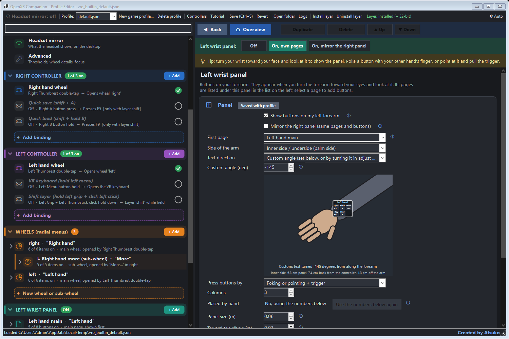
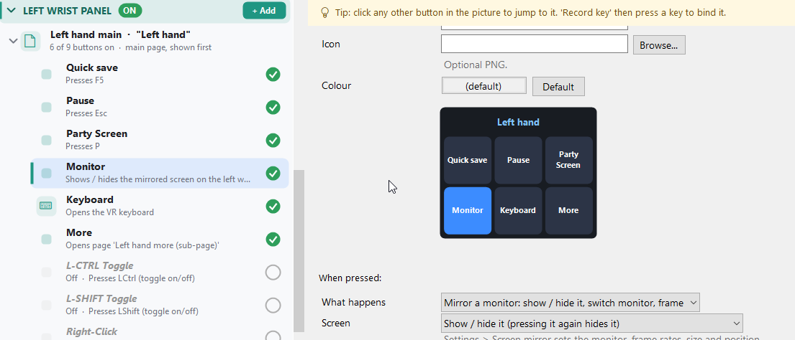

# OpenXR Companion

*Created by Atsuko*

Hand tools for any OpenXR game: radial wheels, wrist panels, button combos, a VR keyboard, your desktop or any window mirrored into VR, controller offsets that fix how the game's hands and guns point, and steadying for shaky hands. (Formerly *OpenXR Hand Menus*.) It's an OpenXR API layer, so it works under Virtual Desktop (VDXR), SteamVR OpenXR, Meta Link, Pimax and other runtimes without patching the game or the runtime, the same way OpenXR Toolkit loads. A desktop editor sets everything up, with per-game profiles.

**[Download the latest release](https://github.com/AtsukoK/OpenXR-Companion/releases/latest)** · **[My other work and support on Patreon](https://www.patreon.com/cw/AtsukoK)** · **[Buy me a coffee on Ko-fi](https://ko-fi.com/atsukok)**

## Screenshots

**Wrist panel:** turn your wrist toward you and look at it. Poke a button with your other hand (a ring shows where you'll touch), or point at it and pull the trigger.

**Radial wheel:** opens in front of you. Pick an item with the stick or by pointing. Items can open sub-wheels.

**Adjust mode:** grab the wheel, the wrist panels or the mirrored screen with the grip and put them anywhere, at any angle; the stick resizes them.

Screenshots from Mount & Blade II: Bannerlord in VR.

## Install

1. Download `OpenXRCompanion-vX.Y.Z.zip` from the [latest release](https://github.com/AtsukoK/OpenXR-Companion/releases/latest) and **extract the whole zip** to a folder it can stay in. The game loads the layer from there.
2. Run `OpenXRCompanionEditor.exe`. The first time, it asks which controllers you use, so it can pick the buttons that open the wheels, and offers a two-minute tour.
3. Click **Install layer** in the toolbar (needs admin, because OpenXR layers are registered under HKLM). The toolbar then shows "Layer: installed".
4. Start any OpenXR game. A message at the bottom of your view, "OpenXR Companion: default.json loaded", means the layer is running.
5. Change things in the editor and save (Ctrl+S). A running game reloads the profile within a second.

## 32-bit games (Fallout: New Vegas, Fallout 3, Tale of Two Wastelands with TTWVR)

32-bit games load only 32-bit OpenXR layers, from a separate registry list. The zip has a 32-bit copy of the layer in the `x86` folder, and the editor's **Install layer** button installs it together with the 64-bit one (one admin prompt). The toolbar shows "Layer: installed (+ 32-bit)" when both are set up.

1. Install as above (the editor is the same for both).
2. Click **Install layer** in the editor. That's all. (Without the editor: right-click `x86\install.ps1` > **Run with PowerShell** as admin, or from an admin PowerShell: `powershell -ExecutionPolicy Bypass -File x86\install.ps1`). It registers `x86\XR_APILAYER_NOVENDOR_openxr_companion.json` under `HKLM\SOFTWARE\WOW6432Node\Khronos\OpenXR\1\ApiLayers\Implicit`.
3. Start the game. "OpenXR Companion: default.json loaded" at the bottom of your view means it is running. Both builds share the same profiles, so a per-game profile for New Vegas is `profiles\FalloutNV.json`.
4. **Uninstall layer** removes both (or run `x86\uninstall.ps1` as admin).

Tested with TTWVR on Virtual Desktop (VDXR).

## Using the editor

The editor opens on the **Overview**: one card per feature, with a switch to turn it on or off and a blue button that jumps to its settings. The list on the left holds everything in the profile, grouped by controller, wheels and wrist panels.

**Bindings** decide what a controller button does. Pick the hand and button, how it's used (press, hold, double tap...), and what happens. You can open a wheel, press a key (**Record key** captures it from your keyboard), run a macro, open the VR keyboard, and more. "+ add another button" makes a combo.

**Wheels** show a live picture. Click a segment to edit that item, use "+ Add item" or "+ Add sub-wheel" under a wheel in the list, and drag items to reorder them.

**Wrist panels** can be off, have their own pages, or mirror the other arm. Set the side of the arm, the text direction and the size here, or move them by hand in the headset with **Adjust positions**.

## Screen mirror (a monitor or window in VR)

Shows one of your monitors, or a single window (a browser, Discord, a video, a Twitch chat), on your wrist or in front of you while you play. You can use it with the laser like a mouse.

### Getting started

1. Turn it on with a **Screen** button. The default profile has a page of them on the left wrist panel: **More > Screen**. You can also add a button with the action **Mirror a monitor** to any wheel or wrist panel.
2. Point at the screen. A button bar appears under it.
3. Press **Choose...** and pick a monitor or window from the list.

The screen starts on your main monitor. Whatever you pick in the headset is saved and becomes the default next time.

### Add a screen button to a wrist panel

1. Open the editor. In the list on the left, unfold your **Left wrist panel** (or right) and select the page you want it on, for example the first page.
2. Click **+ Add** and give the new button a name, for example "Monitor".
3. Under **When pressed**, set **What happens** to **Mirror a monitor**, and **Screen** to **Show / hide it**.
4. Leave **Monitor** on **Keep the current one** and **Or a window** empty, so the button keeps whatever you pick with **Choose...** in the headset. Optionally set **Show it** to the wrist or place you want.
5. Save (Ctrl+S). A running game picks it up within a second.

The same works on a wheel: add an item to any wheel and pick **Mirror a monitor**. Other choices for the button are **Open the list of monitors and windows** (Choose), next / previous monitor or window, next frame rate, and move.

### The button bar

Point at the screen and the bar appears just under it. It stays for 2 seconds after you point away. Point at a button and pull the trigger.

| Button | What it does |
|---|---|
| **Choose...** | A list of every monitor and open window, 12 per page with More / Close. The one showing now has a dot. Your pick is remembered. |
| **Frame rate** | Steps through your frame rates (shown under the name). Set the list in Settings. |
| **Move...** | A list of places: left wrist, right wrist, in front of you (stays where it appears), following your view. **Cancel** leaves it where it is. |
| **Keyboard** | Opens the VR keyboard and brings the mirrored window to the front, so typing goes into it. Click the text box first (for example a chat box), then press Keyboard. The game doesn't take the focus back until you close the keyboard. |
| **Adjust** | Turns on Adjust positions: grab the screen (or the wheel, or a wrist panel) with a grip and put it anywhere, at any angle; the stick resizes it. The bar becomes one **Done adjusting** button, which saves. |
| **Hide** | Turns the screen off. |

### Using the desktop on it

- Point at the screen: the mouse follows the laser.
- **Trigger** = left click (hold to drag), **A / X** = right click, **stick up/down** = scroll.
- While you point at the screen, those buttons don't reach the game. When you point away, the game gets its buttons and its window back.
- On a mirrored window, a click first brings that window to the front, so it lands in the right app even if something covers it.
- The hand on the arm with a wrist screen can't point at it (use the other hand).

### Recommended settings (Settings > Screen mirror)

| Setting | Recommended | Why |
|---|---|---|
| Show | **A whole monitor** to start | Then use **Choose...** in the headset; your pick is saved here automatically. |
| Frame rate cap | **15-30 fps** | Plenty for chat, guides and browsing. Use 60 for video. Lower = less CPU/GPU. 0 = as fast as the headset. |
| Frame rates to switch between | `10, 15, 30, 60, 0` | What the Frame rate button steps through. |
| Where it shows | **Left wrist** (or **In front of me** for videos) | Then place it exactly by hand with **Adjust**. |
| Button bar size | **0.7** | 1 = as wide as the screen. Raise it if the buttons are hard to hit. |
| Use the desktop by pointing at it | **On** | Off = view only. |
| Give the game its window back after clicking | **On** | Otherwise the game may stop reacting after you click on the desktop. |
| Sharpness limit | **0 (automatic)** | 1920 pixels wide, or 1280 in 32-bit games (Fallout), which have little memory to spare. |
| Show it as soon as the game starts | Off | Turn on if you always want it. |
| Steady the screen | **0** (off), or **0.5** for shaky hands | Keeps a wrist screen still through small shakes; real movements still follow. Pair it with **Settings > Pointing > Steady the laser** for a steadier mouse. |

**On your Screen buttons, leave "Monitor" on "Keep the current one" and "Or a window" empty.** Then the button just shows and hides the screen, and your **Choose...** pick stays. A button with a fixed monitor or window always switches to that one.

### Good to know

- Monitors are numbered from left to right; "Main monitor" is whichever one Windows uses as main.
- A remembered window comes back by its exact title if it's still open, otherwise another window of the same program.
- Windows still show when other windows cover them, but not while they're minimised.
- On Windows 10, Windows draws a yellow frame around a window while it's being mirrored (Windows 11 doesn't).
- The picture only updates when something changes, and never faster than the cap.
- Protected video (some streaming apps) shows black; that is a Windows rule. Mirroring the monitor the game itself is on can show black or a frozen picture.
- Lowest frame rate cap is 1 fps.

## Files and switching it off

Turn it off for one game with `enabled: false` in that game's profile. Remove it entirely with **Uninstall layer**. Setting the environment variable `DISABLE_XR_APILAYER_NOVENDOR_openxr_companion=1` also disables it.

Files live in `%LOCALAPPDATA%\OpenXRCompanion\`:
- `profiles\default.json` is used by every game that has no profile of its own.
- `profiles\<exe name>.json` is a per-game profile (for example `profiles\bannerlord.json`).
- `profiles\icons\*.png` holds optional item icons.
- `logs\<exe name>.log` is one log per game, and is the first place to look when something doesn't work.

## Concepts

**Inputs** are written `hand.part[.feature]`:

| part | notes |
|---|---|
| `a` `b` (right) / `x` `y` (left) | also `primary` / `secondary`; add `.touch` for capacitive touch |
| `trigger`, `grip` | analog, pressed past `thresholds.press_on`; `trigger.touch` |
| `thumbstick` | click; `.touch`, `.up` `.down` `.left` `.right` for directions |
| `thumbrest` | touch only (Quest/Touch controllers) |
| `menu` | left menu button (Touch); both hands on WMR/Vive |

**Chords**: `left.grip+right.b` means hold left grip, then press B. The last input is the trigger and the others must already be held. When several bindings match the same press, the most specific one wins (more chord inputs or more layer conditions). This lets `right.b` stay the game's B while `left.grip+right.b` does something else.

**Gestures**: `press`, `tap` (quick release; can share a button with a `hold`), `hold` (after `hold_ms`), `double_tap`, `while_held` (start on press, stop on release).

**Layers** change what normal buttons do. A binding with `"action": {"type": "layer", "layer": "shift", "mode": "hold"}` turns `shift` on while held, or use `toggle`, `on` or `off`. Any binding with `"layers": "shift"` only works while that layer is on, and its button is hidden from the game. That gives you a whole second set of controls.

**Blocking**: `block` on a binding hides its trigger (`trigger`) or all its chord buttons (`all`) from the game while held. `tap_passthrough` on a hold binding sends the game a short press if you let go early, so one button can do "tap = game, hold = mine". While a wheel is open, `block_while_open` hides input from the game: `none`, `minimal`, `hand` or `all`. A blocked button stays hidden until you let go of it, so the game never sees a half press.

**Actions**

| type | fields | |
|---|---|---|
| `key` | `keys` ("Ctrl+S", "F5", "LMB", "WheelUp", "Num5"), `mode` tap/hold/toggle, `tap_ms` | SendInput with scan codes |
| `sequence` | `steps`: `Ctrl+C; wait 100; down W; wait 1500; up W` | macro |
| `xr_input` | `target` input, `mode` tap/hold/toggle | makes the game think a controller button is pressed (remap) |
| `wheel` | `wheel` name, `confirm` auto/release/stick_return/button | opens a wheel, or a submenu inside one |
| `back`, `close` | | wheel navigation |
| `layer` | `layer`, `mode` hold/toggle/on/off | |
| `reload` | | reload the profile |

**Wheel confirm modes**
- `stick_return`: push the stick toward an item and let it spring back. This is the default for thumbrest or touch openers, because your thumb leaves the thumbrest to use the stick.
- `release`: hold the opener, point the stick, let go. Resting on a submenu item for `submenu_dwell_ms` opens it.
- `button`: the confirm button (`selection.confirm_button`) picks the item.
- In every mode the confirm button also works, and the cancel button (`selection.cancel_button`, default B/Y) goes back or closes.

**Placement** (`style.anchor`): `head_locked` (default; appears in front of you, 0.70 m away, and stays put), `head` (follows your view), `hand_locked` (appears above the opening hand and stays put), or `hand` (follows the hand). The wheel always turns to face you. `selection.method` is `both` by default (stick or pointer); `thumbstick` or `point` allow only one.

## Limits
- OpenXR games only. Games that use the SteamVR (OpenVR) API or the Oculus LibOVR API never load OpenXR layers.
- The wheel is drawn for D3D11 and D3D12 games. Vulkan or OpenGL games still get the bindings, chords and layers, but no visible wheel.
- Keys go to the foreground window. If a game ignores them, try `focus_game_window: true`.
- Multiplayer games with anti-cheat may object to any injected layer.

## Building

Needs Visual Studio Build Tools (C++ with CMake) and the .NET 10 SDK.

- Layer: `cmake -S layer -B layer/build -A x64` then `cmake --build layer/build --config Release`
- Editor: `dotnet publish editor/OpenXRCompanionEditor.csproj -c Release -o editor/bin/publish`
- `build_all.ps1` does both and fills `dist\` (it uses the author's local tool paths in `layer\build.bat`).

`layeruildro_test.exe` runs the offline engine tests. The GitHub Actions workflow builds the same tester package on every push.

## Support

If OpenXR Companion is useful to you, you can support its development and find my other VR mods on **[Patreon](https://www.patreon.com/cw/AtsukoK)**. Bug reports and ideas are welcome as [GitHub issues](https://github.com/AtsukoK/OpenXR-Companion/issues).

You can also buy me a coffee or a beer sometimes through my Ko-fi: https://ko-fi.com/atsukok

## Licence

GPLv3, see [LICENSE](LICENSE). Changes per version: [CHANGELOG.md](CHANGELOG.md). Third-party code: [nlohmann/json](third_party/nlohmann) (MIT) and the [OpenXR SDK](third_party/openxr-sdk) (Apache-2.0); their licences are kept in their folders. Code signing: see [CODE_SIGNING_POLICY.md](CODE_SIGNING_POLICY.md).
