# OpenXR Companion

*by Atsuko*

Hand tools for any OpenXR game: **radial wheels**, **wrist panels** with buttons on your forearms, **button combos**, a **VR keyboard**, your **desktop or any window in VR**, a **headset mirror** window for recording and streaming, **controller offsets** that fix how the game's hands and guns point, **stick shaping** for jump-on-stick games, and **steadying** for shaky hands.

It's an OpenXR API layer, so it works under Virtual Desktop (VDXR), SteamVR OpenXR, Meta Link, Pimax and other runtimes, without patching the game or the runtime. A desktop editor sets everything up, and most of it can also be changed inside the headset.

**[Download the latest release](https://github.com/AtsukoK/OpenXR-Companion/releases/latest)** · **[My other work and support on Patreon](https://www.patreon.com/cw/AtsukoK)** · **[Buy me a coffee on Ko-fi](https://ko-fi.com/atsukok)**

> **New in v0.3.0:** a completely new editor, with a guided setup of your menu positions at the start of your first game, a Getting started guide with animations, tutorials, and a lot more. Coming from v0.2.13? See [Updating](#updating-from-an-older-version). The old README is kept [here](docs/README-v0.2.13-winforms.md).

| Wrist panel | Radial wheel |
|---|---|
|  |  |

---

## Get started (about 5 minutes)

### 1. Download and install

1. Download `OpenXRCompanion-vX.Y.Z.zip` from the [latest release](https://github.com/AtsukoK/OpenXR-Companion/releases/latest) and **extract the whole zip** to a folder it can stay in (not Program Files). Your games load the layer from there.
2. Start **`OpenXRCompanionEditor.exe`**.
3. The first time, it asks **which controllers you use** (Quest, Index, WMR, Vive, Steam Frame...), so it can pick the buttons that open your wheels, and offers a short guided tour.
4. Click **Install layer** on the toolbar (one admin prompt: OpenXR layers are registered for the whole PC). The toolbar then says **Layer: installed**.

### 2. Set up your menu positions on your first game

Everyone's arms and play space are different, so the first thing to do is put the wrist panels, the wheel, the screen and the keyboard where **you** like them. The editor makes this a guided walk-through at the start of your next game.

At the top of the **Overview** is this card. For a new install it is already switched on; you can switch it on again any time to redo the setup.

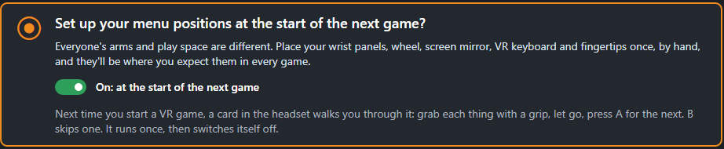

Now start your VR game. A few seconds in, a card appears above the middle of your view and walks you through each thing:

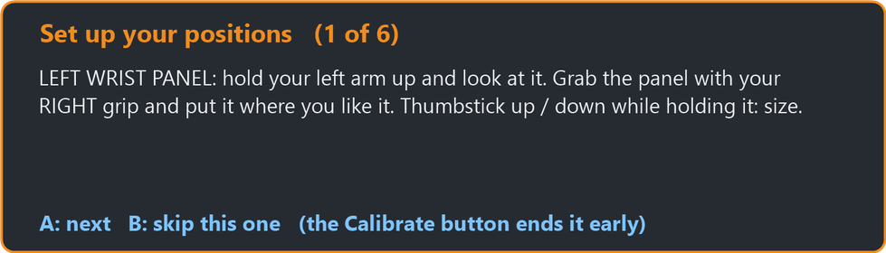

| Step | What you do |
|---|---|
| 1. Left wrist panel | Hold your left arm up and look at it. Grab the panel with your **right grip** and put it where you like it. Thumbstick up / down while holding it: size. |
| 2. Right wrist panel | The same, mirrored (grab it with your left grip). |
| 3. Radial wheel | It shows at your hand. Grab it with the other hand's grip and move it where it's easy to reach. |
| 4. Screen mirror | Your desktop shows. Grab it and put it where you'd like to read it. |
| 5. VR keyboard | It opens by itself. Grab it and put it where typing is comfortable. |
| 6. Fingertips | A small fingertip shows on each controller. Grab one with the other hand's grip and put it where your real fingertip is, so touching panel buttons lands exactly where you expect. |

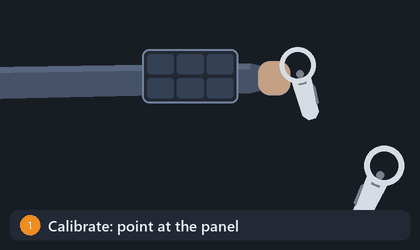

- After you let go of something, the card says **Placed**. Press **A** (or X) for the next step, or grab it again to fine-tune it.
- **B** (or Y) skips a step you don't use.
- While the setup runs, A, B, X and Y don't reach the game.
- At the end everything is saved and the setup switches itself off, so your next game starts normally.

Your positions are saved to **your own copy** of the profile (`user_defaults.json`), which becomes the selected one. The standard profile stays untouched, so updates never overwrite your setup. To change things later: **Calibrate Menu Positions** on either wrist panel's Configuration page, or switch the Overview card on again.

### 3. Use it

**Show a wrist panel:** turn your forearm toward your face, like checking a watch, and look at it. Press its buttons with your other hand: touch them with your fingertip, or point at them and pull the trigger.

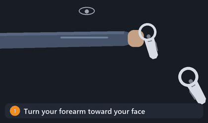

**Open a radial wheel:** depends on the controllers you picked. Quest, Rift and Pico: **double-tap the thumb rest**. Index, Pimax and Bigscreen: double-click the thumbstick. WMR and Vive: hold the menu button. Point at an item and pull the trigger, or push the thumbstick toward it.

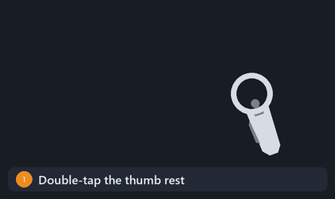

**Laser, touch, or both:** if buttons trigger by accident, choose one way to press. **How you press** at the top of the Wheels and Wrist panels pages sets it for everything at once, or for each separately.

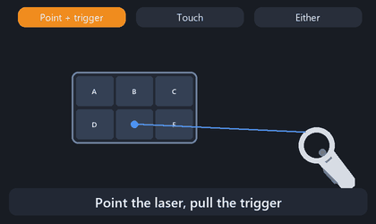

**Change anything** in the editor and press **Save** (Ctrl+S). A running game picks it up within a second, no restart.

---

## The default wrist panels

Both arms come with the same panel: everything you need to set up and use OpenXR Companion, close at hand. Make it the basis of your setup; keep what you like, change the rest.

| Page | Buttons |
|---|---|
| First page | **Quick save / F5**, **Pause / ESC**, **Screen Mirror** (your desktop on your wrist), **Open VR Keyboard**, **-> Configuration Page** |
| Configuration Page | **Quick load / F9**, **Reload profile**, **Calibrate Menu Positions** (move panels, wheels, screen and keyboard by hand), **Controller offsets Configuration**, **VR mirror to Desktop** (the headset mirror window), **OpenXR Companion Ingame Editor** (the editor inside the headset) |

And the default wheels:

| Wheel | Items |
|---|---|
| Right hand (double-tap the right thumb rest) | Map, Inventory, Pause, Screenshot, Quick save, More... (Quick load, Keyboard, Adjust positions, Reload profile) |
| Left hand (double-tap the left thumb rest) | Walk toggle, Crouch toggle, Keyboard, Copy + paste, Chat, Reload profile |

## The editor inside the headset

**OpenXR Companion Ingame Editor** on the Configuration page opens a menu in VR, where you can change wheels, buttons and controller bindings without taking the headset off. While it is open, the game gets no controller input, so you don't walk, shoot or jump by accident.

| A button on a wheel | A wheel | Your controllers |
|---|---|---|
| 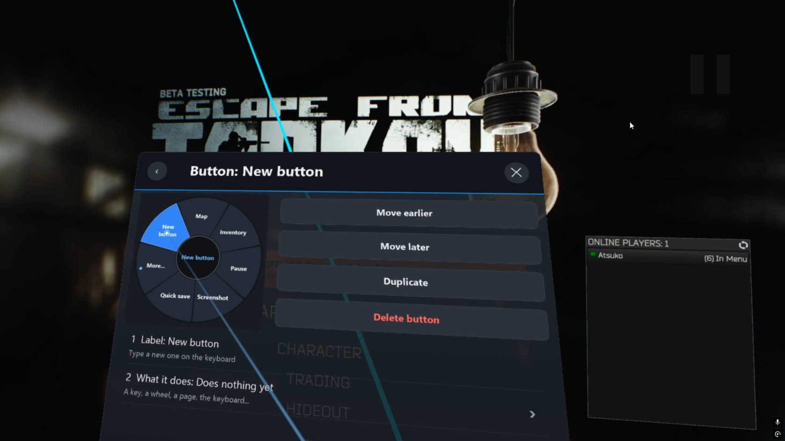 | 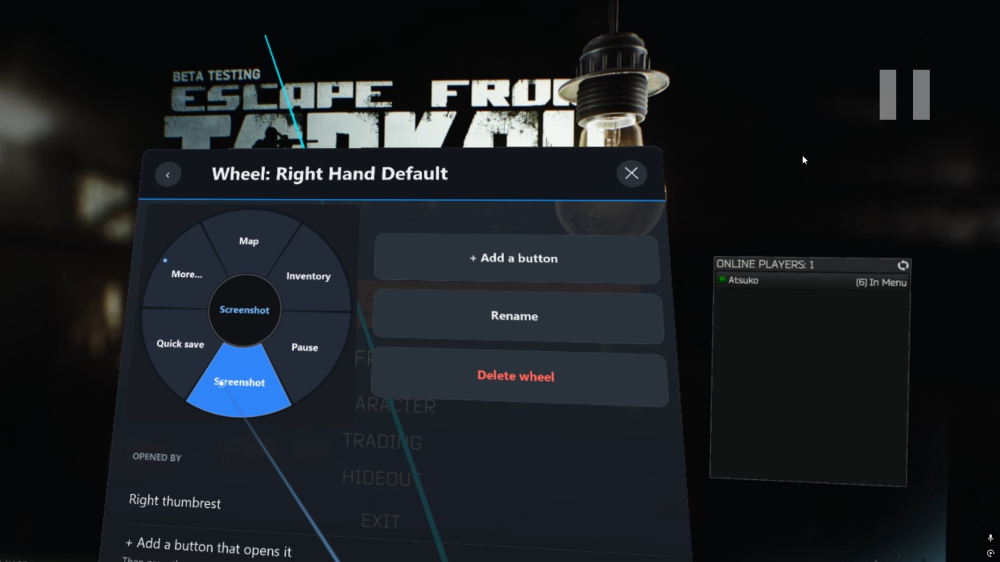 | 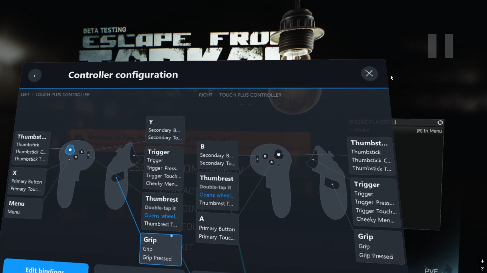 |

## The desktop editor

The editor opens on the **Overview**: the setup card, one card per feature with a switch to turn it on or off, and a **Getting started** guide on the right that plays by itself (it pauses while your mouse is over it). It walks through every button of the default panels, with animations.

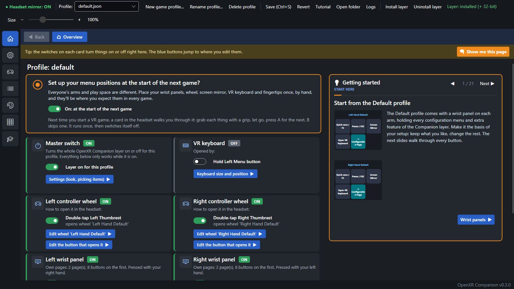

The bar on the left goes to each part: Overview, Settings, Controllers, All bindings, Wheels, Wrist panels and Tutorials. Every page has a **Show me this page** button for a short tour, and the **Tutorials** page has the full tour and how-tos (sprint with a double flick, give a button a second job on hold, swap two buttons, show your desktop on your wrist, fix how hands and guns point).

| Wheels | A wheel |
|---|---|
| 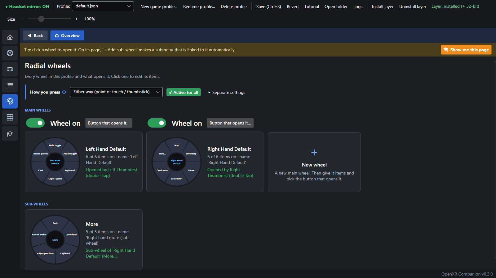 | 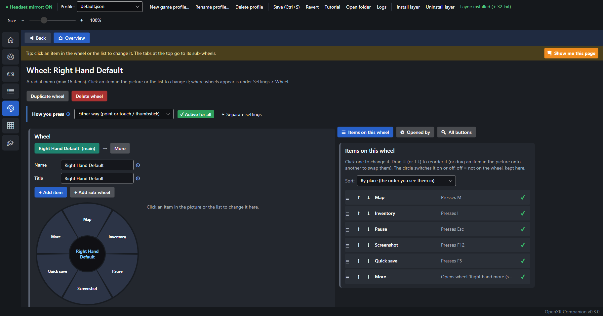 |

| A wrist panel | Your controllers |
|---|---|
| 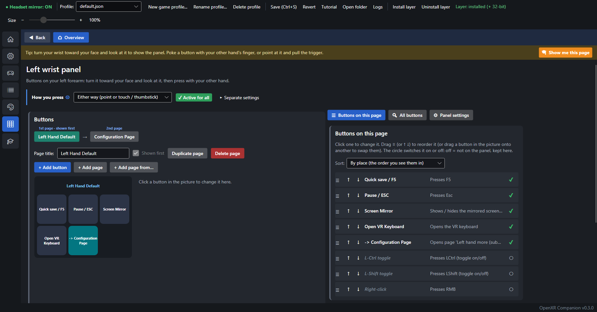 | 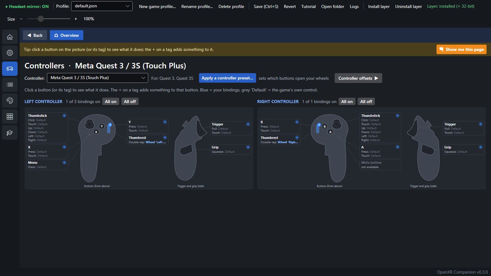 |

- **Wheels and wrist panels:** click an item in the picture or the list to change it. Drag ≡ to reorder. Up to 16 items per wheel, sub-wheels, as many wrist pages as you like. **+ Add page from...** copies pages from another profile or the standard one.
- **Controllers:** click any button on the controller pictures to see what it does, and **+** to give it a job: a key, a wheel, a macro, a game button, the keyboard... **Apply a controller preset** sets the usual buttons for your controllers.
- **All bindings:** everything in the profile in one searchable list; the search also finds settings.
- **Key behaviour:** a key on a controller button acts like the real key (held while you hold the button), or **Toggle** (press once to hold it down, again to let go). On wheels and panels a key is one quick press.
- **Size** on the toolbar (or Ctrl + / Ctrl -) makes the whole editor bigger or smaller. It stays sharp at any Windows scaling.
- **Profiles:** the profile you select at the top is the one your games use. **New game profile...** makes one used only by one game.

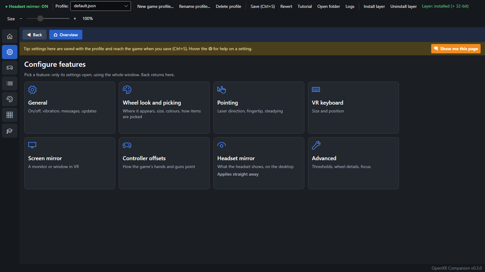

---

## Stick options (jump and crouch on a stick)

Many games put jump on right-stick up, crouch on down and turning on left / right. When you push forward to jump, the stick usually leans a little, and the game turns you too. Click a stick on the **Controllers** page:

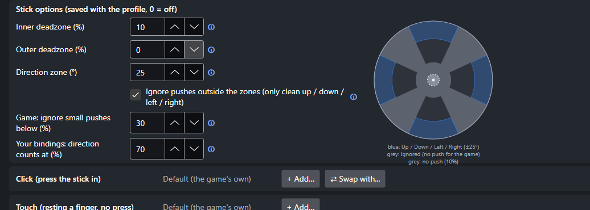

| Setting | What it does |
|---|---|
| **Inner deadzone** | Pushes smaller than this give the game nothing (stops drift). |
| **Outer deadzone** | The last part toward the edge already counts as fully pushed. |
| **Direction zone (°)** | A push within this many degrees of up, down, left or right becomes exactly that direction **for the game**: forward with a lean is a clean jump, no turn. |
| **Ignore pushes outside the zones** | Diagonals give the game nothing, so the stick only ever sends a clean up, down, left or right. |
| **Game: ignore small pushes below (%)** | With the box above ticked: small pushes give the game nothing either. 0 = off. |
| **Your bindings: direction counts at (%)** | Only for bindings **you** add on stick directions (for example "push up = a key"). The game isn't affected. |

The picture shows it: blue is what reaches the game, grey is ignored. **Everything is off by default.** For jump on right-stick up, try a direction zone of 25 to 30° with *Ignore pushes outside the zones* ticked. The same settings are in the headset (stick > Directions), with a live picture of the stick.

## Screen mirror (a monitor or window in VR)

Shows one of your monitors, or a single window (a browser, Discord, a video, a chat), on your wrist or in front of you while you play. Use it with the laser like a mouse.

1. Press **Screen Mirror** on a wrist panel. It starts on your main monitor.
2. Point at the screen: a button bar appears under it.
3. **Choose...** lists every monitor and open window. Your pick is remembered.

| Button | What it does |
|---|---|
| **Choose...** | Pick a monitor or a window (12 per page). |
| **Frame rate** | Steps through your frame rates. 15-30 fps is plenty for chat and guides; 60 for video. |
| **Move...** | Left wrist, right wrist, in front of you, or following your view. |
| **Keyboard** | Opens the VR keyboard and brings the mirrored window to the front, so typing goes into it. |
| **Adjust** | Grab the screen with a grip and put it anywhere; the stick resizes it. |
| **Hide** | Turns the screen off. |

- Point at the screen: the mouse follows the laser. **Trigger** = left click (hold to drag), **A / X** = right click, **stick up / down** = scroll. While you point at it, those buttons don't reach the game.
- **Dock the keyboard:** the bar under the VR keyboard has **Dock screen above keys**, so the screen sits just above the keys and moves with them.
- Windows still show when covered, but not while minimised. Protected video shows black (a Windows rule).

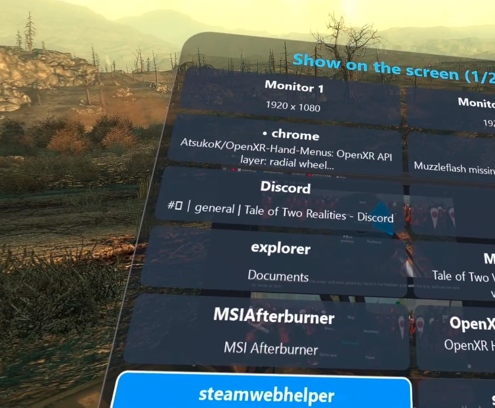

## Headset mirror (what the headset shows, on your monitor)

A desktop window showing what the headset shows, **including the wheel, wrist panels, screen, lasers and messages** (a game's own mirror can't show those). For recording or streaming (capture the window in OBS), or for someone watching.

- Turn it on with the first button on the editor's toolbar, or **VR mirror to Desktop** on a wrist panel. Closing the window turns it off.
- **Settings > Headset mirror:** eye (left, right or both), presets, zoom, head camera smoothing, frame rate cap, always on top. Changes apply straight away.
- The mirror never takes focus from the game. D3D11 games for now.

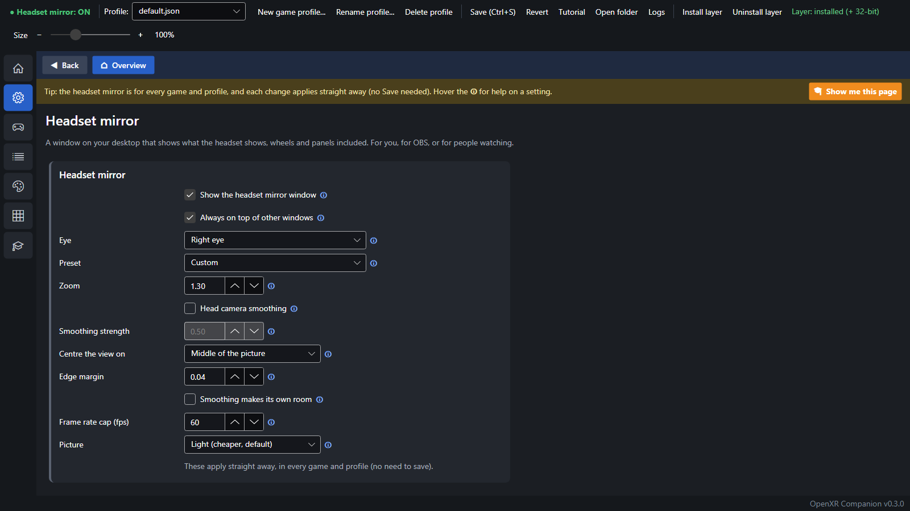

## Controller offsets (fix how the game's hands point)

Turns and moves the controllers the **game** sees (its hands, guns and laser), for games whose hands point too low or that have no pitch setting. Each game's profile keeps its own numbers.

- **In the headset:** **Controller offsets Configuration** on a wrist panel. + / - buttons for each angle and position, or **Grab to set**: hold the grip and turn the controller until the game's hand feels right.
- **In the editor:** Settings > Controller offsets, as sliders, for both hands mirrored or each on its own.

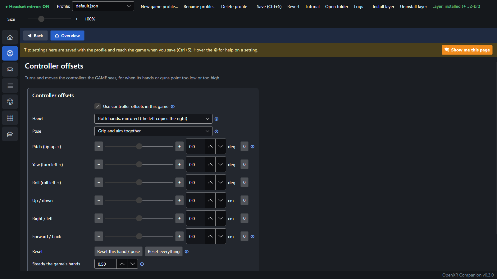

## Steadying for shaky hands

All off by default; 0.5 is a good start. Each one holds still through small shakes but follows straight away when you really move.

| Setting | What it steadies |
|---|---|
| Settings > Pointing > **Steady the laser** | the laser, and the mouse on a mirrored screen |
| Settings > Screen mirror > **Steady the screen** | a screen on your wrist or following your view |
| Settings > Controller offsets > **Steady the game's hands** | the hands and guns in the game |
| Settings > Headset mirror > **Head camera smoothing** | the headset mirror window only |

## Experimental features

> ⚠ **Motion sickness warning.** These can make you feel sick, sometimes quickly. They are hidden and off by default.

Tick **Settings > Advanced > Show experimental features** to see the **Experimental** page. **Head smoothing** steadies the direction the game looks from, like a camera stabiliser, for using the headset as a camera. Use **For recording** (the headset view stays normal); it switches itself off every time a game starts unless you tick *Keep it on*.

---

## Updating from an older version

When a new version is out, a blue **Update available** button appears on the editor's toolbar. Click it and choose **Update now**: the editor downloads the release from GitHub, checks it against GitHub's checksum, keeps your current files in a `_previous_version` folder, swaps the files and restarts. Your profiles and settings are not touched. Close your VR games first; a running game keeps the old layer until you restart it.

> **Coming from v0.2.15 or older:** the old editor's updater may say **"The update didn't finish"** after updating. It did finish: just start the editor again, and it opens the new one. (Or download the zip and extract it over your old folder.)

Your profiles carry over. The new standard profile has the new wrist panels; your own `user_defaults.json` and game profiles are kept as they are. To start from the new panels, pick `default.json` in the profile list, or copy pages with **Wrist panels > + Add page from...**.

## 32-bit games (Fallout: New Vegas, Fallout 3, Tale of Two Wastelands with TTWVR)

The zip has a 32-bit copy of the layer in the `x86` folder, and **Install layer** installs it together with the 64-bit one (the toolbar shows "Layer: installed (+ 32-bit)"). Both use the same profiles. **Uninstall layer** removes both. Tested with TTWVR on Virtual Desktop (VDXR).

## SteamVR and Steam Frame

OpenXR Companion works with any OpenXR runtime, SteamVR included, as long as the game runs through OpenXR. Games that use SteamVR's own OpenVR API never load it; if a game offers both, pick its OpenXR mode. A log appearing in `%LOCALAPPDATA%\OpenXRCompanion\logs` means it loaded.

- **Steam Frame:** pick Steam Frame on the Controllers page and tick **Use all the Steam Frame's buttons**. Restart the game after changing bindings.
- If the headset says "OpenXR Companion gets no controller input", reset the game's bindings in SteamVR's controller settings, then restart the game.

## Files, switching it off and problems

Files live in `%LOCALAPPDATA%\OpenXRCompanion\` (**Open folder** on the toolbar):

- `profiles\default.json` is the **standard** profile. It is refreshed with every release.
- `profiles\user_defaults.json` holds **your own** defaults: changes to the standard (from the editor or the headset) go there, and it is never overwritten.
- Any other `profiles\*.json` is a profile of your own. `active_profile.txt` names the selected one, which your games use.
- `setup_positions.json` is the "set up my positions at the next game" switch; `headset_mirror.json`, `head_smoothing.json` and `steam_frame.json` hold those settings for every game.
- `logs\<game>.log`: one log per game (**Logs** on the toolbar). The first place to look when something doesn't work.

Turn it off for one game with the **Master switch** on that game's profile, or entirely with **Uninstall layer**.

**Reporting a problem:** open a [GitHub issue](https://github.com/AtsukoK/OpenXR-Companion/issues) with what you did and what happened, your headset and runtime (Virtual Desktop, SteamVR, Link...), the game, and the log.

### Limits

- OpenXR games only. Games that use the SteamVR (OpenVR) or Oculus LibOVR API never load OpenXR layers.
- Wheels and panels are drawn for D3D11 and D3D12 games. Vulkan or OpenGL games still get the bindings, but no visible menus.
- Keys go to the foreground window.
- Multiplayer games with anti-cheat may object to any injected layer.

## Profile reference (for editing the JSON by hand)

Everything can be set in the editor; this is for people who prefer the files. The format is the same as in v0.2.x.

- **Inputs** are written `hand.part[.feature]`: `a` `b` / `x` `y` (also `primary` / `secondary`), `trigger`, `grip`, `thumbstick` (`.up` `.down` `.left` `.right`), `thumbrest`, `menu`; add `.touch` for touch.
- **Chords:** `left.grip+right.b` = hold left grip, then press B.
- **Gestures:** `press`, `tap`, `hold` (after `hold_ms`), `double_tap`, `while_held`, `double_tap_hold`.
- **Actions:** `key` (`keys`, `mode` tap/toggle), `sequence` (`steps`), `xr_input` (`target`), `wheel`, `back`, `close`, `layer`, `reload`, `page`, `keyboard`, `adjust`, `screen`, `controller_offsets`, `headset_mirror`, `settings_menu`.
- **Sticks:** `"sticks": { "right": { "inner_deadzone": 0.1, "outer_deadzone": 0, "direction_angle": 25, "ignore_outside": true, "ignore_center": 0.3 } }`. All 0 / false (off) when left out.
- **Layers, blocking, confirm modes and placement** work as described in the [v0.2.13 reference](docs/README-v0.2.13-winforms.md#profile-reference-for-editing-the-json-by-hand).

## Building

Needs Visual Studio Build Tools (C++ with CMake) and the .NET 10 SDK.

- Layer: `cmake -S layer -B layer/build -A x64` then `cmake --build layer/build --config Release` (32-bit: `-A Win32` into `layer/build32`).
- Editor (Avalonia): `dotnet publish editor/OpenXRCompanionEditor.csproj -c Release -r win-x64 --self-contained -p:PublishSingleFile=true -o editor/bin/publish`. The data side is in `core/`.
- `build_all.ps1` does both and fills `dist\` (it uses the author's local tool paths in `layer\build.bat`).

`layer\build\vro_test.exe` runs the offline layer tests. The editor has its own checks (`--nochange`, `--clicktest`, `--tourtest`...).

## Support

If OpenXR Companion is useful to you, you can support its development and find my other VR mods on **[Patreon](https://www.patreon.com/cw/AtsukoK)**, or buy me a coffee on **[Ko-fi](https://ko-fi.com/atsukok)**. Bug reports and ideas are welcome as [GitHub issues](https://github.com/AtsukoK/OpenXR-Companion/issues).

## Licence

GPLv3, see [LICENSE](LICENSE). Changes per version: [CHANGELOG.md](CHANGELOG.md). Third-party code: [nlohmann/json](third_party/nlohmann) (MIT), the [OpenXR SDK](third_party/openxr-sdk) (Apache-2.0), [Avalonia](https://avaloniaui.net/) (MIT); their licences are kept in their folders and in `THIRD_PARTY_NOTICES.txt`. Code signing: see [CODE_SIGNING_POLICY.md](CODE_SIGNING_POLICY.md).
