# OpenXR Companion

*by Atsuko*

Hand tools for any OpenXR game: radial wheels, wrist panels, button combos, a VR keyboard, your desktop or any window mirrored into VR, a headset mirror window for recording and streaming, controller offsets that fix how the game's hands and guns point, and steadying for shaky hands. (Formerly *OpenXR Hand Menus*.) It's an OpenXR API layer, so it works under Virtual Desktop (VDXR), SteamVR OpenXR, Meta Link, Pimax and other runtimes without patching the game or the runtime, the same way OpenXR Toolkit loads. A desktop editor sets everything up, with as many profiles as you like; the one you select is the one your games use.

**[Download the latest release](https://github.com/AtsukoK/OpenXR-Companion/releases/latest)** · **[My other work and support on Patreon](https://www.patreon.com/cw/AtsukoK)** · **[Buy me a coffee on Ko-fi](https://ko-fi.com/atsukok)**

## What it does

| Feature | In short |
|---|---|
| [Radial wheels](#quick-start) | Menus that open from a controller button; pick with the stick or by pointing. Sub-wheels, key presses, macros, toggles. |
| [Wrist panels](#the-default-left-wrist-panel) | Buttons on your forearm that appear when you look at it. |
| [Bindings and combos](#using-the-editor) | Any controller button, double tap, hold or combo can press keys, run macros, open wheels or switch layers. |
| [In-game settings menu](#in-game-settings-menu) | A panel in the headset to change bindings and stick deadzones without taking it off. |
| [Controller buttons](#controller-buttons) | A picture of your controller: click a button to make it (or just touching it) press a key, act as another of the game's buttons, or turn it off for the game. |
| [VR keyboard](#quick-start) | Type into the game or a mirrored window. |
| [Screen mirror](#screen-mirror-a-monitor-or-window-in-vr) | A monitor or one window on your wrist or in front of you, usable with the laser like a mouse. |
| [Headset mirror](#headset-mirror-what-the-headset-shows-on-your-monitor) | A desktop window with what the headset shows, overlays included. For OBS or someone watching. |
| [Controller offsets](#controller-offsets-fix-how-the-games-hands-point) | Fix how the game's hands and guns point, per game. |
| [Steadying](#steadying-for-shaky-hands) | Smooths the laser, the wrist screen and the game's hands for shaky hands. |
| [Experimental](#experimental-features) | Hidden, off by default: head smoothing for using the headset as a camera (can cause motion sickness). |

## Screenshots

**Wrist panel:** turn your wrist toward you and look at it. Poke a button with your other hand (a ring shows where you'll touch), or point at it and pull the trigger.

**Radial wheel:** opens in front of you. Pick an item with the stick or by pointing. Items can open sub-wheels.

**Adjust mode:** grab the wheel, the wrist panels or the mirrored screen with the grip and put them anywhere, at any angle; the stick resizes them.

Screenshots from Mount & Blade II: Bannerlord in VR.

## Install

1. Download `OpenXRCompanion-vX.Y.Z.zip` from the [latest release](https://github.com/AtsukoK/OpenXR-Companion/releases/latest) and **extract the whole zip** to a folder it can stay in. The game loads the layer from there.
2. Run `OpenXRCompanionEditor.exe`. The first time, it asks which controllers you use, so it can pick the buttons that open the wheels, and offers a two-minute tour.
3. Click **Install layer** in the toolbar (needs admin, because OpenXR layers are registered under HKLM). The toolbar then shows "Layer: installed".
4. Start any OpenXR game. A message at the bottom of your view, "OpenXR Companion: default.json loaded", means the layer is running.
5. Change things in the editor and save (Ctrl+S). A running game reloads the profile within a second. **The profile you select in the editor's Profile list is the one your games use** (a running game switches within a second). Your changes to the standard profile are saved as `user_defaults.json`, so updates never overwrite them.

### Updating

When a new version is out, an orange **Update available** button appears at the top right of the editor. Click it and choose **Yes**: the editor downloads the release from GitHub, checks it against GitHub's checksum, keeps your current version in a `_previous_version` folder, swaps the files and restarts. Your profiles and settings are not touched. Close your VR games first; a game that is running keeps the old version until you restart it. (Or download the zip and extract it over the old folder, as before.)

### 32-bit games (Fallout: New Vegas, Fallout 3, Tale of Two Wastelands with TTWVR)

32-bit games load only 32-bit OpenXR layers, from a separate registry list. The zip has a 32-bit copy of the layer in the `x86` folder, and the editor's **Install layer** button installs it together with the 64-bit one (one admin prompt). The toolbar shows "Layer: installed (+ 32-bit)" when both are set up.

1. Install as above (the editor is the same for both).
2. Click **Install layer** in the editor. That's all. (Without the editor: right-click `x86\install.ps1` > **Run with PowerShell** as admin, or from an admin PowerShell: `powershell -ExecutionPolicy Bypass -File x86\install.ps1`). It registers `x86\XR_APILAYER_NOVENDOR_openxr_companion.json` under `HKLM\SOFTWARE\WOW6432Node\Khronos\OpenXR\1\ApiLayers\Implicit`.
3. Start the game. "OpenXR Companion: default.json loaded" at the bottom of your view means it is running. Both builds share the same profiles and use the one selected in the editor.
4. **Uninstall layer** removes both (or run `x86\uninstall.ps1` as admin).

Tested with TTWVR on Virtual Desktop (VDXR).

## Quick start

- **Open a wheel**: depends on the controllers you picked in the editor (**Controllers** button). Quest, Rift and Pico: double-tap that hand's thumbrest. Index, Pimax and Bigscreen: double-click that hand's thumbstick. WMR, HP Reverb and Vive: hold that hand's menu button. Pick an item by pushing the stick toward it and letting it spring back, or by pointing at it and pulling the trigger.
- **Wrist panels**: turn your wrist toward your face and look at it. Poke a button with your other hand (a ring shows where you'll touch), or point at it and pull the trigger.
- **Put things where you like them**: left wrist panel > More > **Calibrate Positions**. Grab a wheel, a wrist panel, the screen or the VR keyboard (open it with its Keyboard button first) with your other hand's grip and move it; the stick resizes it. Press it again to save.
- **Change anything** in the editor and save (Ctrl+S). A running game picks it up within a second.

### The default left wrist panel

New profiles start with the tools you need to set things up close at hand:

| Page | Buttons |
|---|---|
| Main | Quick save, Pause, **Monitor** (your screen on your wrist), Keyboard, More |
| More | Quick load, Reload profile, **Calibrate Positions** (move wheels, panels and the screen by hand), **Controller offsets**, **Headset mirror**, **Screen options** |
| Screen options | On my wrist, In front of me, Next monitor, Choose window, Frame rate, Move it, Screen off |

Older profiles keep their own panels; add any of these buttons in the editor.

## Using the editor

The editor opens on the **Overview**: one card per feature, with a switch to turn it on or off and a blue button that jumps to its settings. The list on the left holds everything in the profile, grouped by controller, wheels and wrist panels.

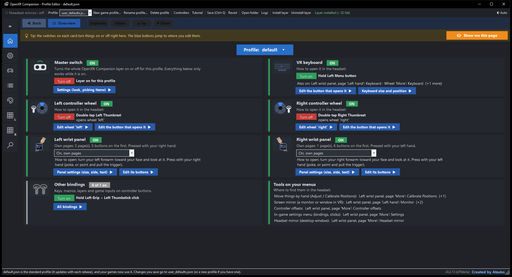

**Bindings** decide what a controller button does. Pick the hand and button, how it's used (press, hold, double tap...), and what happens. You can open a wheel, press a key (**Record key** captures it from your keyboard), run a macro, open the VR keyboard, and more. "+ add another button" makes a combo.

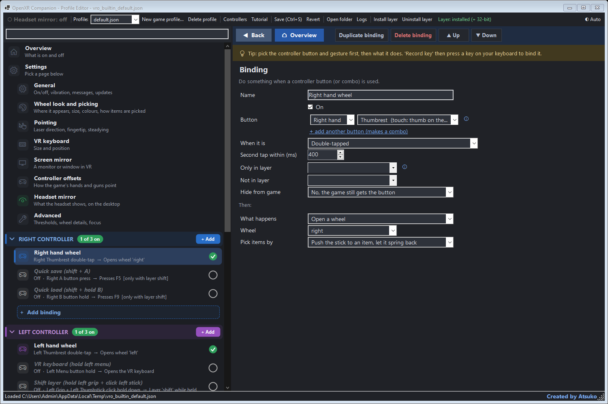

### Controller buttons

Click **Right controller** or **Left controller** in the list to see a drawing of your controller. Pick your controller type at the top (Quest 3 / 3S, Quest 2 / Rift S, Quest Pro, Pico 4, Valve Index and Index-style controllers such as the Steam Frame's, Vive wands, Windows Mixed Reality, HP Reverb G2). Buttons that already do something show a blue number.

Click a button to see each way of using it: pressing it, just touching it (resting a finger on it, where the controller can feel that), pushing the stick up, down, left or right. Each lists what it does now (normal bindings first, then those that only work in a layer such as shift), and **+ Add…** offers:

- **+ Press a key**: holds a keyboard key or mouse button down while you use it.
- **+ Act as another button**: the game sees another of its buttons instead, for as long as you hold it (like remapping in SteamVR).
- **Turn off in the game**: the game no longer sees that button.
- **+ Something else**: any other action (a wheel, a macro, a layer...) in the binding editor.
- **Double flick** (stick directions; double-tap and hold on buttons): press a key held for as long as you keep pushing after a quick second flick, like sprinting on a double flick forward. The game still gets the stick.

Click the **thumbstick** for its **stick options** (saved with the profile, all off at 0): an **inner deadzone** and **outer deadzone** for what the game sees from the stick, and a **direction zone** so a forward push that leans a little sideways doesn't also count as left or right for your bindings.

The **Hold:** choices keep the button's normal use in the game: your choice starts only when you hold the button (0.4 s), the game doesn't see it while you hold, and a quick tap still reaches the game as a normal press. Like the Bannerlord VR radial menu on a held button.

These make ordinary bindings, listed under the controller, so you can change or switch them off later. A touch binding never hides the button's presses from the game. Parts OpenXR Companion can't read (system buttons, the Index trackpad, the WMR touchpad) are shown greyed out.

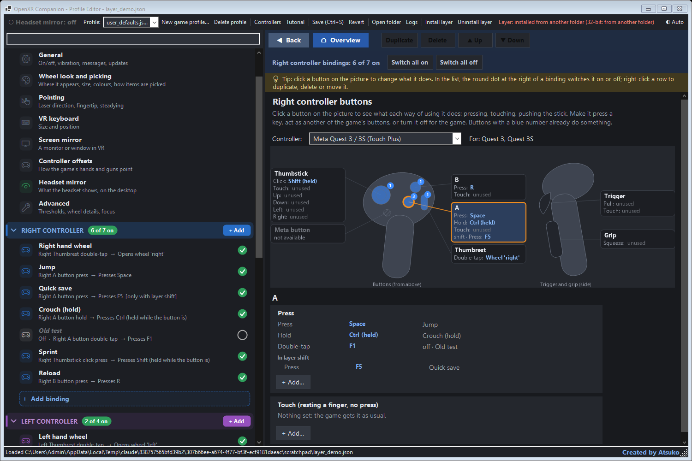

All controller pictures

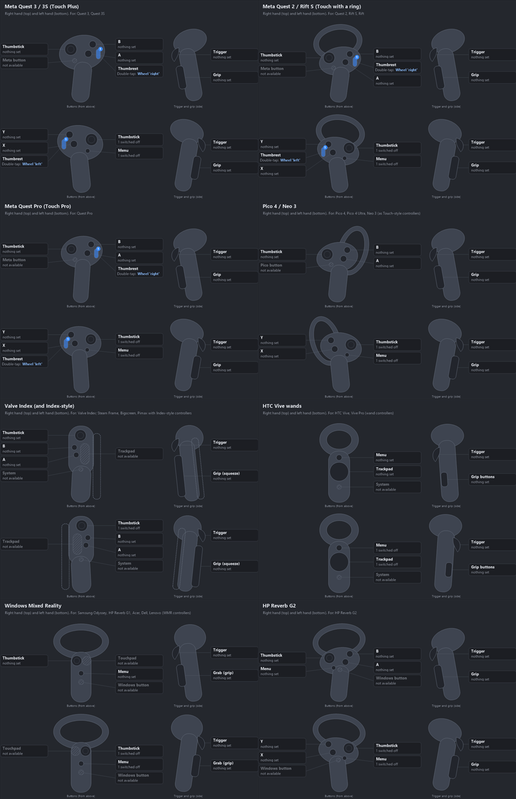

**Wheels** show a live picture. Click a segment to edit that item, use "+ Add item" or "+ Add sub-wheel" under a wheel in the list, and drag items to reorder them.

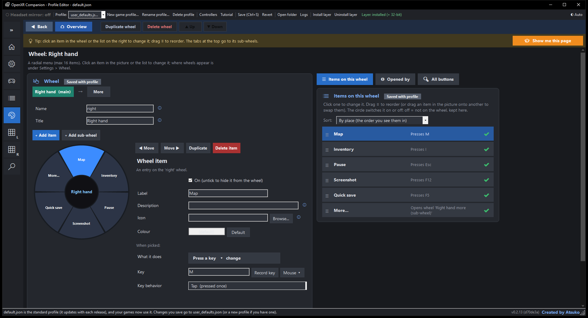

**Wrist panels** can be off, have their own pages, or mirror the other arm. Set the side of the arm, the text direction and the size here, or move them by hand in the headset with **Adjust positions**.

**Settings** is split into short pages in the list: General, Wheel look and picking, Pointing, VR keyboard, Screen mirror, Controller offsets, Headset mirror and Advanced. Each section is a card tagged **Saved with profile** (press Save) or **Applies straight away**. Hover or click an (i) icon for help. The search box at the top finds settings as well as items. The button on the right of the toolbar switches between **Dark** (the default), **Light** and **Auto** (follows Windows).

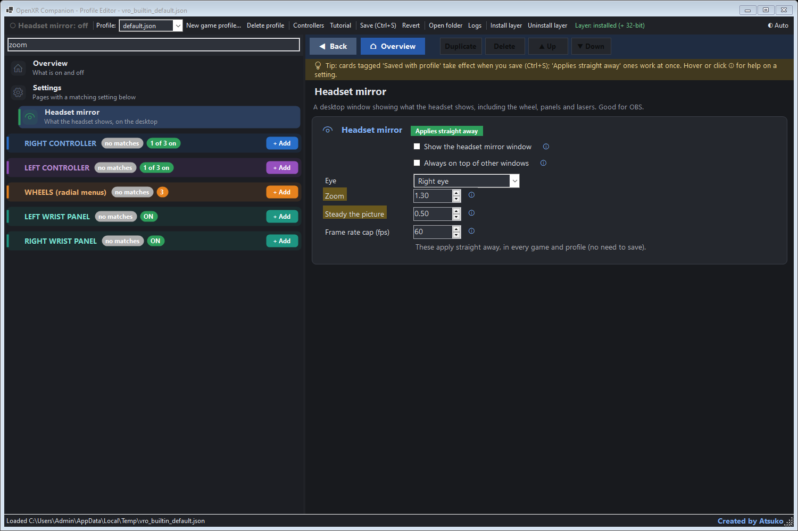

## In-game settings menu

Change your bindings and sticks without taking the headset off. Open it with **Settings** on the left wrist panel's **More** page (or give any button or wheel item the **In-game settings menu** action). Point at it with the laser and pull the trigger; the stick scrolls (up / down) and changes the number you point at (left / right).

- **Test controllers**: both controllers drawn live: what you press lights up, what you touch gets a ring, the stick dot moves, and the trigger and grip fill their bars. Handy to check a controller works and which button is which.
- **Right / Left bindings**: the controller drawn live at the top, then every binding on that controller. Open one to switch it on or off, choose its **button** (press *Button*, then just press the button you want), **press or touch**, **when** (press, quick tap, hold, double-tap, while held, double-tap and hold), its **key** (press *Key*, then the key on the VR keyboard), whether the key is tapped, held or toggled, and whether the **game still sees the button**. **+ New binding**: press a button, then a key. Bindings that do something else (a wheel, a macro) can be switched on or off and moved to another button here; what they do is changed in the editor.
- **Right / Left stick**: the stick drawn to scale with its zones, where it is now (white) and what the game sees (blue ring), plus the inner and outer deadzone, the direction zone and how far a direction has to be pushed.
- **Controller offsets** opens its own panel.

Changes work at once and are saved to the profile a second later, so the editor shows them too.

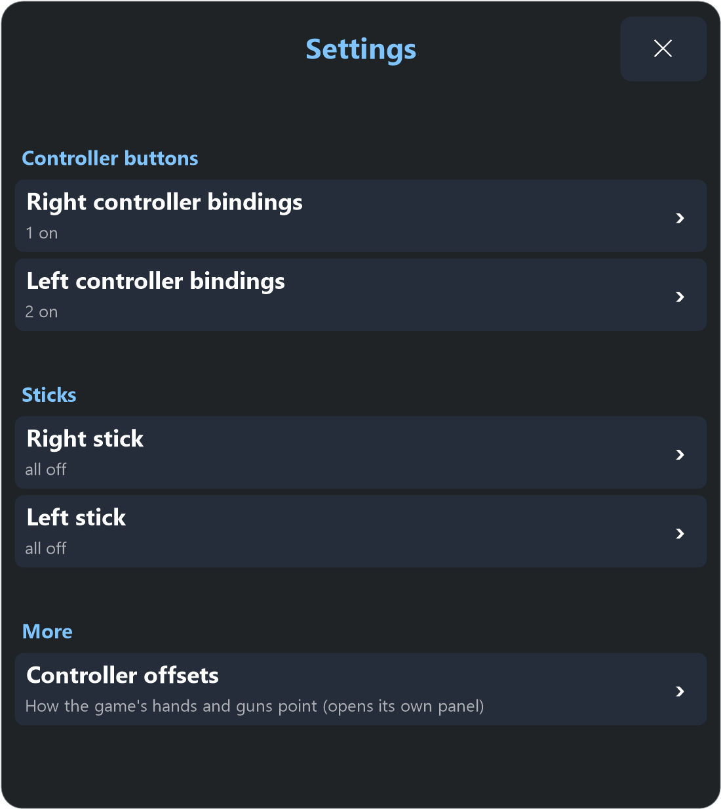

## Screen mirror (a monitor or window in VR)

Shows one of your monitors, or a single window (a browser, Discord, a video, a Twitch chat), on your wrist or in front of you while you play. You can use it with the laser like a mouse.

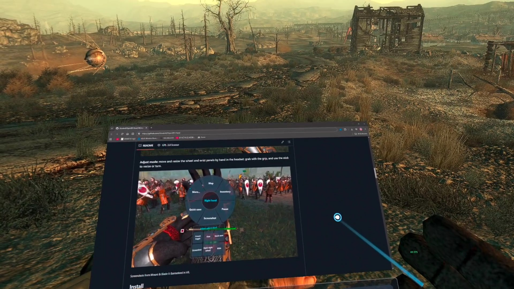

### Getting started

1. Turn it on with a **Screen** button. The default left wrist panel has **Monitor** on its first page and a page of screen buttons under **More > Screen options**. You can also add a button with the action **Mirror a monitor** to any wheel or wrist panel.
2. Point at the screen. A button bar appears under it.
3. Press **Choose...** and pick a monitor or window from the list.

The screen starts on your main monitor. Whatever you pick in the headset is saved and becomes the default next time.

### Add a screen button to a wrist panel

1. Open the editor. In the list on the left, unfold your **Left wrist panel** (or right) and select the page you want it on, for example the first page.
2. Click **+ Add** and give the new button a name, for example "Monitor".
3. Under **When pressed**, set **What happens** to **Mirror a monitor**, and **Screen** to **Show / hide it**.
4. Leave **Monitor** on **Keep the current one** and **Or a window** empty, so the button keeps whatever you pick with **Choose...** in the headset. Optionally set **Show it** to the wrist or place you want.
5. Save (Ctrl+S). A running game picks it up within a second.

The same works on a wheel: add an item to any wheel and pick **Mirror a monitor**. Other choices for the button are **Open the list of monitors and windows** (Choose), next / previous monitor or window, next frame rate, and move.

### The button bar

Point at the screen and the bar appears just under it. It stays for 2 seconds after you point away. Point at a button and pull the trigger.

| Button | What it does |
|---|---|
| **Choose...** | A list of every monitor and open window, 12 per page with More / Close. The one showing now has a dot. Your pick is remembered. |
| **Frame rate** | Steps through your frame rates (shown under the name). Set the list in Settings. |
| **Move...** | A list of places: left wrist, right wrist, in front of you (stays where it appears), following your view. **Cancel** leaves it where it is. |
| **Keyboard** | Opens the VR keyboard and brings the mirrored window to the front, so typing goes into it. Click the text box first (for example a chat box), then press Keyboard. The game doesn't take the focus back until you close the keyboard. |
| **Adjust** | Turns on Adjust positions: grab the screen (or the wheel, or a wrist panel) with a grip and put it anywhere, at any angle; the stick resizes it. The bar becomes one **Done adjusting** button, which saves. |
| **Hide** | Turns the screen off. |

### Typing into it: dock the keyboard

Open the VR keyboard. The bar under it has **Dock screen above keys** (the screen sits just above the keyboard and moves with it) and **Dock keys under screen** (the keyboard follows the screen), so you don't have to hold your wrist up while typing. **Adjust dock** lets you grab the docked one with a grip and put it where you like (the stick changes the docked screen's size); press it again to save. Your choice is remembered, and Settings > VR keyboard has it too.

### Using the desktop on it

- Point at the screen: the mouse follows the laser.
- **Trigger** = left click (hold to drag), **A / X** = right click, **stick up/down** = scroll.
- While you point at the screen, those buttons don't reach the game. When you point away, the game gets its buttons and its window back.
- On a mirrored window, a click first brings that window to the front, so it lands in the right app even if something covers it.
- The hand on the arm with a wrist screen can't point at it (use the other hand).

### Recommended settings (Settings > Screen mirror)

| Setting | Recommended | Why |
|---|---|---|
| Show | **A whole monitor** to start | Then use **Choose...** in the headset; your pick is saved here automatically. |
| Frame rate cap | **15-30 fps** | Plenty for chat, guides and browsing. Use 60 for video. Lower = less CPU/GPU. 0 = as fast as the headset. |
| Frame rates to switch between | `10, 15, 30, 60, 0` | What the Frame rate button steps through. |
| Where it shows | **Left wrist** (or **In front of me** for videos) | Then place it exactly by hand with **Adjust**. |
| Button bar size | **0.7** | 1 = as wide as the screen. Raise it if the buttons are hard to hit. |
| Use the desktop by pointing at it | **On** | Off = view only. |
| Give the game its window back after clicking | **On** | Otherwise the game may stop reacting after you click on the desktop. |
| Sharpness limit | **0 (automatic)** | 1920 pixels wide. A bigger picture is halved only while it is more than 1.5 times this. |
| Show it as soon as the game starts | Off | Turn on if you always want it. |
| Steady the screen | **0** (off), or **0.5** for shaky hands | Keeps a wrist screen still through small shakes; real movements still follow. Pair it with **Settings > Pointing > Steady the laser** for a steadier mouse. |

**On your Screen buttons, leave "Monitor" on "Keep the current one" and "Or a window" empty.** Then the button just shows and hides the screen, and your **Choose...** pick stays. A button with a fixed monitor or window always switches to that one.

### Good to know

- Monitors are numbered from left to right; "Main monitor" is whichever one Windows uses as main.
- A remembered window comes back by its exact title if it's still open, otherwise another window of the same program.
- Windows still show when other windows cover them, but not while they're minimised.
- On Windows 10, Windows draws a yellow frame around a window while it's being mirrored (Windows 11 doesn't).
- The picture only updates when something changes, and never faster than the cap.
- Protected video (some streaming apps) shows black; that is a Windows rule. Mirroring the monitor the game itself is on can show black or a frozen picture.
- Lowest frame rate cap is 1 fps.

## Headset mirror (what the headset shows, on your monitor)

A desktop window showing what the headset shows, **including the wheel, wrist panels, mirrored screen, lasers and messages** (a game's own mirror can't show those, because they're added after the game). Good for recording or streaming (capture the window in OBS) or for someone watching.

- Turn it on with the first button on the editor's toolbar, or the **Headset mirror** button on the left wrist panel (More). Closing the window turns it off.
- **Settings > Headset mirror**:
  - **Preset**: sets the options below together (centred where you look, wide with both eyes, the original look, the exact headset view). Change anything afterwards and it shows Custom.
  - **Eye**: left, right, or **both eyes**: centred on where that eye looks, with the other eye filling in the nose side (where one eye's picture ends in a black strip). Far things line up; close things on that side can look a little doubled.
  - **Zoom**: 1 is the whole eye picture, 1.3 looks like a normal camera. The picture always fills the window, so resize the window for another shape.
  - **Head camera smoothing** with its **strength**: irons small head shakes out of the window like a camera stabiliser (on at 0.5 by default; the view in the headset is not changed). It drifts into the picture the zoom leaves out, so it works fully from about zoom 1.3, or turn on **Smoothing makes its own room**.
  - **Centre the view on** where the eye looks (default) or the middle of the picture, and an **Edge margin** that keeps the black strip on the nose side out.
  - **Frame rate cap** (60 is smooth and cheap) and **Picture**: Light (default, draws straight from the game's picture, about half the cost) or Full.
- **Full screen**: maximize the window (button or title double-click) to cover the whole monitor, taskbar included; double-click the picture to go in and out.
- When the game shows only a flat screen (menus, loading screens), the mirror shows that screen.
- **Always on top of other windows** keeps it above the game on your monitor. The mirror never takes focus from the game, even when you click, move or resize it, so the game keeps your keyboard and controller input. Use borderless or windowed mode in the game; exclusive fullscreen can still cover it.
- It never holds the game up. D3D11 games for now.

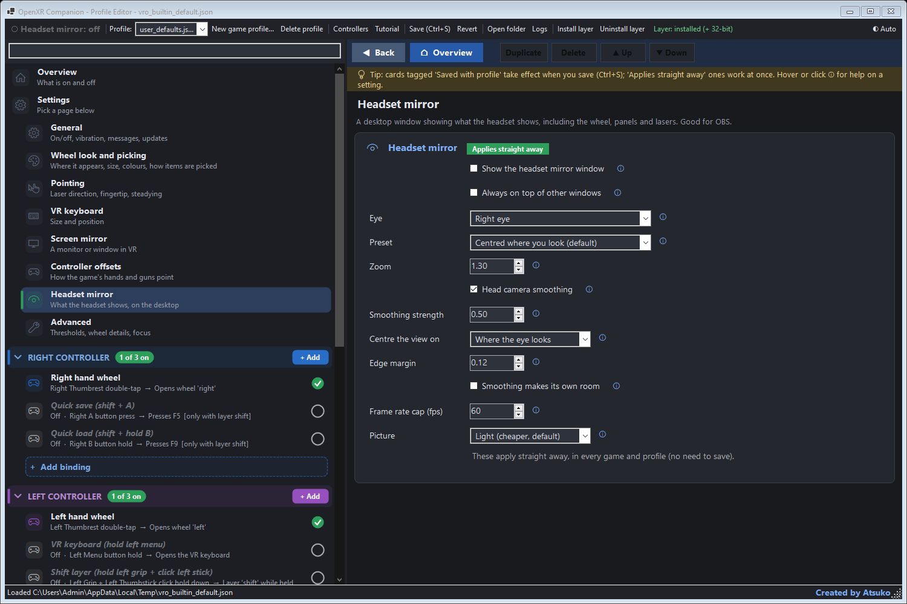

## Controller offsets (fix how the game's hands point)

Turns and moves the controllers the **game** sees (its hands, guns and its own laser), for games whose hands point too low on Quest controllers or that have no pitch setting. Works in any OpenXR game, and each game's profile keeps its own numbers.

- **In the headset**: press **Controller offsets** on the left wrist panel (More). The panel has + / - buttons for pitch, yaw, roll and up/down, left/right, forward/back (hold to repeat, or point at a row and push the stick like a slider). Press a value to reset it. **Grab to set**: hold grip and turn the controller until the game's hand feels right, then let go. Changes save by themselves.
- **In the editor**: Settings > Controller offsets has the same values as sliders, for both hands mirrored or each hand on its own, and for the grip and aim poses together or apart. One tick turns it all off.
- **Steady the game's hands** (off by default) smooths the hands and guns in the game for shaky hands.

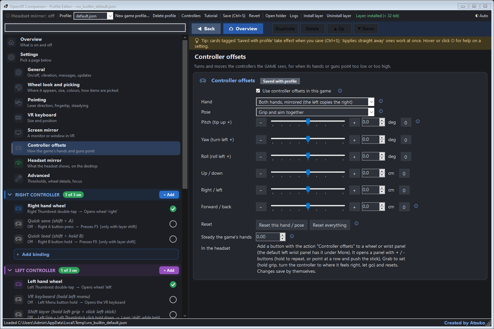

## Steadying for shaky hands

All off by default; 0.5 is a good start. Each one holds still through small shakes but follows straight away when you really move.

| Setting | What it steadies |
|---|---|
| Settings > Pointing > **Steady the laser** | the laser, and the mouse on a mirrored screen |
| Settings > Screen mirror > **Steady the screen** | a screen on your wrist or following your view |
| Settings > Controller offsets > **Steady the game's hands** | the hands and guns in the game |
| Settings > Headset mirror > **Head camera smoothing** | the headset mirror window only (on at 0.5) |

## Experimental features

> ⚠ **Motion sickness warning.** These can make you feel sick, sometimes quickly. They are hidden and off by default.

To see them, tick **Settings > Advanced > Show experimental features**. An **Experimental** page then appears under Settings.

- **Head smoothing** steadies the direction the game looks from, like a camera stabiliser, for using the headset as a camera. The head's position isn't changed.
  - **For recording** (the default): the game's own desktop view and recordings are steadied, but the headset corrects back to your real head, so the world still feels solid. The picture's edge can show briefly in the headset during shakes.
  - **⚠ In the headset too**: you see the steadied picture yourself, so the world moves a little with your head. Much more likely to make you sick.
  - **Strength** 0 to 100: how heavy the camera is. Every movement is smoothed the same way, easing into and out of turns like a weighted camera rig: about 0.12 s of lag per step (2 = smooth, 5 = heavy, 10 = very heavy, up to 100 = 12 s for slow drifting shots). Above about 1 is meant for **For recording**.
  - Turning it on asks you to confirm. It **switches itself off every time a game starts**, unless you tick **Keep it on when a game starts**.
  - Works in games that render from the views OpenXR gives them (most do).

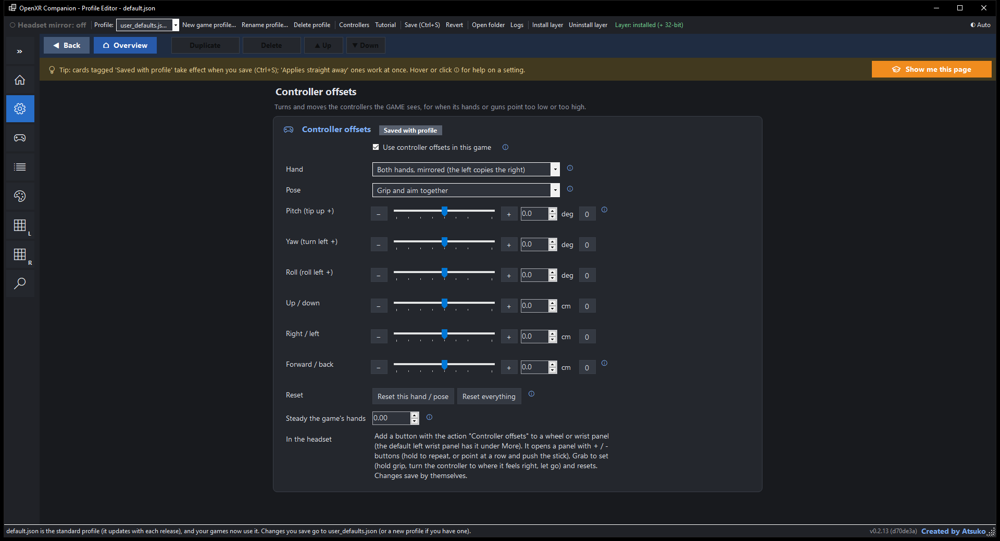

## SteamVR and Steam Frame

OpenXR Companion works with any OpenXR runtime, SteamVR included, as long as the game itself runs through OpenXR.
Games that use SteamVR's own OpenVR API never load it; if a game offers both, pick its OpenXR mode (or use
OpenComposite). A log appearing in `%LOCALAPPDATA%\OpenXRCompanion\logs` means it loaded.

- **Steam Frame and other new controllers** are supported: the layer binds its menus to the inputs the game itself uses on that controller.
- **Steam Frame:** choose the Index-style controllers in the editor's controller choice, and Index bindings in SteamVR. Restart the game after changing bindings: they are fixed when the game starts.
- If the headset shows "OpenXR Companion gets no controller input", SteamVR is using saved bindings for the game that leave the menus out: reset the game's bindings in SteamVR's controller settings, then restart the game.

## Files, switching it off and problems

Turn it off for one game with `enabled: false` in that game's profile. Remove it entirely with **Uninstall layer**. Setting the environment variable `DISABLE_XR_APILAYER_NOVENDOR_openxr_companion=1` also disables it.

Files live in `%LOCALAPPDATA%\OpenXRCompanion\`:
- `profiles\default.json` is the **standard** profile. It is refreshed with every release, so new defaults reach everyone.
- `profiles\user_defaults.json` holds **your own** defaults. The editor creates it the first time you save changes to the standard (changes made in the headset, like controller offsets or placement, go there too). If you already have one, it is never replaced: changes to the standard are saved as a new profile, `user_defaults 2.json`, after a warning.
- Any other `profiles\*.json` is a profile of your own (**New game profile...** makes one).
- `active_profile.txt` names the profile selected in the editor. **Games always use the selected profile.** If none is selected (or it was deleted), a profile named after the game's exe is used (for example `profiles\bannerlord.json`), then `user_defaults.json`, then `default.json`.
- `profiles\icons\*.png` holds optional item icons.
- `headset_mirror.json` and `head_smoothing.json` hold the headset mirror and head smoothing settings (for every game).
- `logs\<exe name>.log` is one log per game, and is the first place to look when something doesn't work.

**Reporting a problem:** open a [GitHub issue](https://github.com/AtsukoK/OpenXR-Companion/issues) with what you did and what happened, your headset and runtime (Virtual Desktop, SteamVR, Link...), the game, and the log (`logs\<game>.log`; the editor's **Logs** button opens the folder).

### Limits
- OpenXR games only. Games that use the SteamVR (OpenVR) API or the Oculus LibOVR API never load OpenXR layers.
- The wheel is drawn for D3D11 and D3D12 games. Vulkan or OpenGL games still get the bindings, chords and layers, but no visible wheel.
- Keys go to the foreground window. If a game ignores them, try `focus_game_window: true`.
- Multiplayer games with anti-cheat may object to any injected layer.

## Profile reference (for editing the JSON by hand)

Everything here can be set in the editor; this is for people who prefer the files.

**Inputs** are written `hand.part[.feature]`:

| part | notes |
|---|---|
| `a` `b` (right) / `x` `y` (left) | also `primary` / `secondary`; add `.touch` for capacitive touch |
| `trigger`, `grip` | analog, pressed past `thresholds.press_on`; `trigger.touch` |
| `thumbstick` | click; `.touch`, `.up` `.down` `.left` `.right` for directions |
| `thumbrest` | touch only (Quest/Touch controllers) |
| `menu` | left menu button (Touch); both hands on WMR/Vive |

**Chords**: `left.grip+right.b` means hold left grip, then press B. The last input is the trigger and the others must already be held. When several bindings match the same press, the most specific one wins (more chord inputs or more layer conditions). This lets `right.b` stay the game's B while `left.grip+right.b` does something else.

**Gestures**: `press`, `tap` (quick release; can share a button with a `hold`), `hold` (after `hold_ms`), `double_tap`, `while_held` (start on press, stop on release), `double_tap_hold` (the second press within `double_tap_ms` starts it, and it lasts while that press is held: a double flick of the stick to sprint).

**Sticks** (all off when left out): `"sticks": { "right": { "inner_deadzone": 0.12, "outer_deadzone": 0.05, "direction_angle": 30 } }`. The deadzones (0 to 0.9 of a full push) change what the game sees from that stick: pushes inside the inner one count as none, the rest is stretched to reach full, and the outer one counts the last part as full. `direction_angle` (degrees, 5 to 45) is for bindings on stick directions: a direction only counts while the stick points within that angle of it, so a forward push that leans sideways doesn't also fire left or right.

**Layers** change what normal buttons do. A binding with `"action": {"type": "layer", "layer": "shift", "mode": "hold"}` turns `shift` on while held, or use `toggle`, `on` or `off`. Any binding with `"layers": "shift"` only works while that layer is on, and its button is hidden from the game. That gives you a whole second set of controls.

**Blocking**: `block` on a binding hides its trigger (`trigger`) or all its chord buttons (`all`) from the game while held. `tap_passthrough` on a hold binding sends the game a short press if you let go early, so one button can do "tap = game, hold = mine". While a wheel is open, `block_while_open` hides input from the game: `none`, `minimal`, `hand` or `all`. A blocked button stays hidden until you let go of it, so the game never sees a half press.

**Actions**

| type | fields | |
|---|---|---|
| `key` | `keys` ("Ctrl+S", "F5", "LMB", "WheelUp", "Num5"), `mode` tap/hold/toggle, `tap_ms` | SendInput with scan codes |
| `sequence` | `steps`: `Ctrl+C; wait 100; down W; wait 1500; up W` | macro |
| `xr_input` | `target` input, `mode` tap/hold/toggle | makes the game think a controller button is pressed (remap) |
| `wheel` | `wheel` name, `confirm` auto/release/stick_return/button | opens a wheel, or a submenu inside one |
| `back`, `close` | | wheel navigation |
| `layer` | `layer`, `mode` hold/toggle/on/off | |
| `reload` | | reload the profile |
| `page` | `page` name | opens another page of a wrist panel |
| `keyboard` | | opens the VR keyboard |
| `adjust` | | Adjust positions (move wheels, wrist panels and the screen by hand) |
| `screen` | `mode` toggle/on/off/choose/next_monitor/next_fps/next_place, `place`, `monitor`, `window` | the screen mirror |
| `controller_offsets` | `mode` panel | opens the controller offsets panel |
| `settings_menu` | | opens or closes the in-game settings menu (bindings, sticks) |
| `headset_mirror` | `mode` toggle/on/off | the headset mirror window |

**Wheel confirm modes**
- `stick_return`: push the stick toward an item and let it spring back. This is the default for thumbrest or touch openers, because your thumb leaves the thumbrest to use the stick.
- `release`: hold the opener, point the stick, let go. Resting on a submenu item for `submenu_dwell_ms` opens it.
- `button`: the confirm button (`selection.confirm_button`) picks the item.
- In every mode the confirm button also works, and the cancel button (`selection.cancel_button`, default B/Y) goes back or closes.

**Placement** (`style.anchor`): `head_locked` (default; appears in front of you, 0.70 m away, and stays put), `head` (follows your view), `hand_locked` (appears above the opening hand and stays put), or `hand` (follows the hand). The wheel always turns to face you. `selection.method` is `both` by default (stick or pointer); `thumbstick` or `point` allow only one.

## Building

Needs Visual Studio Build Tools (C++ with CMake) and the .NET 10 SDK.

- Layer: `cmake -S layer -B layer/build -A x64` then `cmake --build layer/build --config Release`
- Editor: `dotnet publish editor/OpenXRCompanionEditor.csproj -c Release -o editor/bin/publish`
- `build_all.ps1` does both and fills `dist\` (it uses the author's local tool paths in `layer\build.bat`).

`layer\build\vro_test.exe` runs the offline engine tests. The GitHub Actions workflow builds the same tester package on every push.

## Support

If OpenXR Companion is useful to you, you can support its development and find my other VR mods on **[Patreon](https://www.patreon.com/cw/AtsukoK)**. Bug reports and ideas are welcome as [GitHub issues](https://github.com/AtsukoK/OpenXR-Companion/issues).

You can also buy me a coffee or a beer sometimes through my Ko-fi: https://ko-fi.com/atsukok

## Licence

GPLv3, see [LICENSE](LICENSE). Changes per version: [CHANGELOG.md](CHANGELOG.md). Third-party code: [nlohmann/json](third_party/nlohmann) (MIT) and the [OpenXR SDK](third_party/openxr-sdk) (Apache-2.0); their licences are kept in their folders. The controller pictures are outlines traced from the [WebXR input profile models](https://github.com/immersive-web/webxr-input-profiles) (MIT, [licence](third_party/webxr-input-profiles/LICENSE.md)); the Vive wand from ["HTC Vive Controller" by iShoNz](https://sketchfab.com/3d-models/htc-vive-controller-9f03e4a80c5a4b31a24bb122f17cb229) ([CC BY 4.0](https://creativecommons.org/licenses/by/4.0/)); the Steam Frame controllers from [Valve's Steam Frame CAD models](https://gitlab.steamos.cloud/SteamHardware/SteamFrame) (© 2026 Valve Corporation, [CC BY-NC-SA 4.0](https://creativecommons.org/licenses/by-nc-sa/4.0/): those outlines are under the same licence, non-commercial; not associated with or endorsed by Valve); see tools/ControllerSilhouettes. Release zips include THIRD_PARTY_NOTICES.txt. Code signing: see [CODE_SIGNING_POLICY.md](CODE_SIGNING_POLICY.md).
